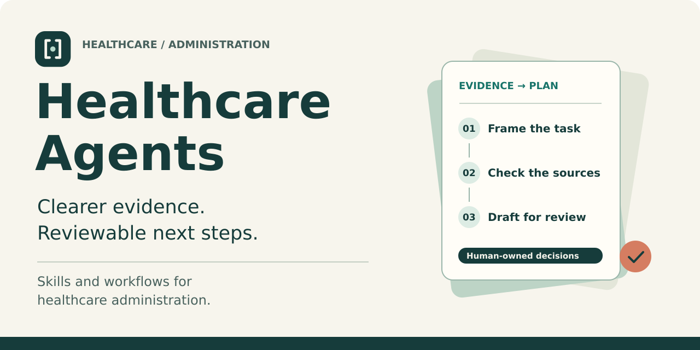
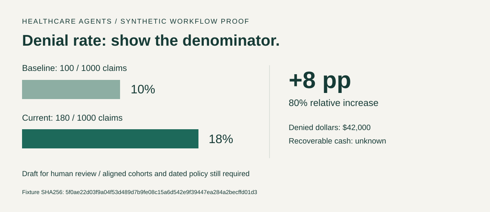
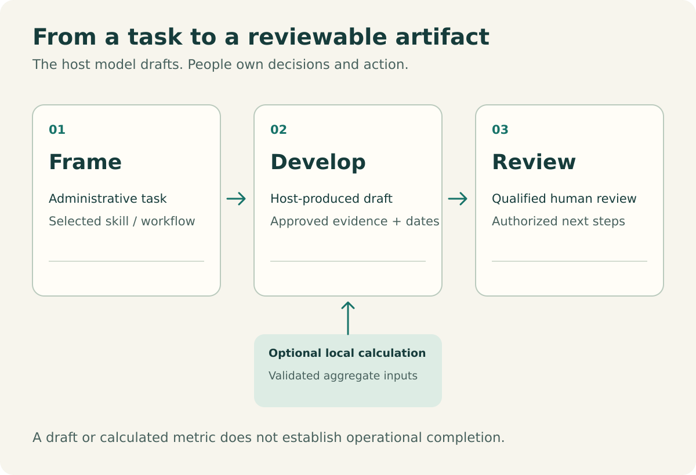

# Healthcare Agents

<picture>
  <source media="(max-width: 640px)" srcset="docs/assets/presentation/hero-mobile.png">
  
</picture>

**Build and customize agents for the way your healthcare team works.**

Healthcare Agents is a starting point for healthcare leaders to describe a workflow, adapt focused instructions and review the resulting work with a human owner. Start with your own task or use an existing specialist: investigate a denial spike, map survey evidence gaps or prepare an appeal packet. Local tools can validate inputs and calculate supported aggregate quantities.

[Customize a workflow](#quickstart) · [Workflows](#six-workflows-six-useful-outputs) · [Specialists](#explore-the-specialist-catalog) · [Host setup](#connect-your-ai-host) · [Evidence & evaluation](#what-the-evidence-establishes)

> **Development candidate · v2.0.0-beta.1**
> This README describes the checked-out beta. Publication is pending: `npx healthcare-agents` from the public registry does not yet deliver this candidate. Customer cloud-host qualification is also pending. See [candidate status](docs/admin-v2/release-status.json) and the [tested local Codex profile](docs/platforms/admin-v2-stdio-bridge.md).

## Quickstart

Start with the work you need to produce. Adapt a small instruction pack, review it against supplied evidence, then use it in your approved host:

| I want to… | Start here | What I get |
| --- | --- | --- |
| **Build my own workflow** | [CHNA interview-plan walkthrough](docs/usage/custom-workflow-walkthrough.md) | An editable local pack, case template and review checklist |
| **Try a synthetic workflow** | Run the local example below | Validated aggregate calculations, with evidence and limitations |
| **Use the skill in my AI host** | [Connect an approved host](#connect-your-ai-host), then use a prompt below | A task-specific draft from the host model |
| **Find a specialist** | [Explore the catalog](#explore-the-specialist-catalog) | A focused role or workflow for the question |

### Make a community interview plan

Suppose you need a community health needs assessment (CHNA) stakeholder interview plan. Describe the decision it supports, the evidence you have, the people whose voices are missing and the person who must approve outreach. The [walkthrough](docs/usage/custom-workflow-walkthrough.md) turns those choices into an editable local instruction pack, then shows how to review, revise or retire it.

Start from the [community interview example](workflows/admin-v2/custom-example.json). The builder checks its structure and creates files for your host to read. Your host drafts the plan; a community benefit director reviews the evidence, coverage, recruitment and consent before anyone is contacted. Building the pack does not install or activate it.

[Review brief](docs/usage/custom-workflow-review-template.md) · [Integration brief](docs/usage/custom-workflow-integration-brief.md)

### Try the local denial example

This reproducible example pins the source beta baseline; use the [installation guide](INSTALL.md) for channel and host choices. Use an existing Node.js installation (the [local profile](docs/platforms/admin-v2-stdio-bridge.md) requires Node ≥18.14.1) and npm:

```bash
git clone https://github.com/ajhcs/healthcare-agents.git
cd healthcare-agents
git checkout --detach 7b536b5ba707a74cc3b9208b658606f36c9a92c8
npm ci --ignore-scripts
node bin/cli.js admin run examples/admin-v2/denial-spike-workup.json
```

The [synthetic case](examples/admin-v2/denial-spike-workup.json) compares 100 denied claims out of 1,000 with 180 out of 1,000: **10% → 18%, up 8 percentage points**. These are invented demonstration data, not patient records or measured customer outcomes. The calculation does not establish a cause or recoverable cash.



To inspect a workup draft with an explicit workflow selection:

```bash
node bin/cli.js workup "Commercial payer denial rate jumped" \
  --workflow denial-spike-workup --json
```

**The CLI routes tasks, validates contracts and calculates supported quantities. The host model writes the administrative artifact.** The CLI does not call a model or execute the operational workplan.

### Ask your host for a useful artifact

After [host setup](#connect-your-ai-host), try one of these prompts with synthetic or approved aggregate evidence:

> Use Healthcare Agents to investigate this denial-rate increase. Compare the supplied cohorts, separate observations from hypotheses, list missing evidence, and draft a recovery plan with owners and completion checks.

> Use Healthcare Agents to review our survey evidence inventory. Map each supplied standard to its evidence, identify gaps, and return an owner-led retest checklist. Keep compliance conclusions with the accountable reviewer.

> Use Healthcare Agents to prepare an administrative prior authorization appeal packet. Work from the supplied policy, decision and document inventory. Show source references, missing documents and deadline assumptions for human review.

[More starter prompts](docs/usage/starter-prompts.md) · [Example workup packets](docs/examples/workup-packets.md)

## Six workflows, six useful outputs

| Start with | Get a reviewable artifact | Supported local calculation |
| --- | --- | --- |
| [Denial spike](skills/healthcare-denial-spike-workup/SKILL.md) | Cohort comparison, hypotheses, evidence pulls and recovery owners | Baseline/current rates, percentage points and relative change |
| [Ambulatory access backlog](skills/healthcare-ambulatory-access-backlog/SKILL.md) | Demand/capacity scenario and monitored access plan | Shortfall, net weekly capacity and backlog clearance scenario |
| [Survey readiness gaps](skills/healthcare-survey-readiness-gap-review/SKILL.md) | Standard-to-evidence gap register and retest plan | Missing-evidence counts; no compliance certification |
| [Prior authorization appeal](skills/healthcare-prior-authorization-appeal-workup/SKILL.md) | Source-linked administrative packet and document gap map | Supplied calendar window and missing documents |
| [Payer underpayment](skills/healthcare-payer-contract-underpayment-review/SKILL.md) | Contract-linked variance register | USD line/net variance, with overpayments retained |
| [Discharge barriers](skills/healthcare-discharge-barrier-workplan/SKILL.md) | Aggregate barrier owners and dependencies | Supplied barrier counts and reported avoidable days |

All six have [synthetic cases](examples/admin-v2/), evidence requirements and observable completion gates. Read the [workflow catalog](workflows/admin-v2/catalog.json) and [case contract](docs/admin-v2/case-contract.md) for exact fields and validation rules.

<picture>
  <source media="(max-width: 640px)" srcset="docs/assets/presentation/workflow-mobile.png">
  
</picture>

Choose a workflow or specialist, combine approved evidence with optional local calculations, draft in the host, then review with a qualified human owner. A draft or calculated metric does not establish operational completion.

Every numeric input needs a source record, origin and as-of date. Missingness, contradictory evidence and unknown recoverable cash stay visible. Synthetic and aggregate modes cannot be silently mixed; invalid dates, unexpected fields and impossible denominators fail validation.

## Explore the specialist catalog

The existing **51 specialists across 10 administrative domains** and **16 workups** remain available. Start with the [selection guide](docs/usage/agent-selection-guide.md), [workup directory](docs/workflows/README.md) or CLI:

```bash
node bin/cli.js list --domain revenue
node bin/cli.js show revenue-cycle-specialist
node bin/cli.js admin list
```

| Domain | Specialists |
| --- | --- |
| Clinical Operations | 8 |
| Emergency Preparedness | 1 |
| Health IT & Informatics | 6 |
| Operations & Administration | 7 |
| Payer & Managed Care | 6 |
| Pharmacy Programs | 2 |
| Population Health & Community Health | 3 |
| Quality, Safety & Compliance | 7 |
| Revenue Cycle & Finance | 6 |
| Strategy & Advisory | 5 |

The [Healthcare Agents router skill](skills/healthcare-agents/SKILL.md) loads the selected workflow or [compact role brief](skills/healthcare-agents/references/roles/); full [specialist prompts](agents/) remain available when needed. Free-text `choose` and `workup` calls offer discovery candidates. The user or host interprets intent, negation and multiple goals, then supplies validated IDs or a structured selection. Explicit multi-selections retain every workstream. See [routing authority and migration](docs/admin-v2/routing-authority.md).

## Connect your AI host

Start with the [installation guide](INSTALL.md) and choose the profile for your approved environment. The [local Codex profile](docs/platforms/admin-v2-stdio-bridge.md) documents preparation, activation, removal and exact tested-host limits. It uses existing Node/npm; Python is optional through `--stdio-bridge`. Other clients need separate acceptance.

[Host capabilities, limitations and developer commands](docs/usage/development-checks.md#integration-developer-reference) · [Custom workflow integration brief](docs/usage/custom-workflow-integration-brief.md)

## Extend a workflow or bring source receipts

### Build a local workflow

Define the outcome, specialist, human owner, evidence fields and acceptance criteria using the [example contract](workflows/admin-v2/custom-example.json) or [builder skill](skills/healthcare-workflow-builder/SKILL.md):

```bash
node bin/cli.js admin validate workflows/admin-v2/custom-example.json
node bin/cli.js admin build workflows/admin-v2/custom-example.json --output ./community-workflow
```

The new directory contains `SKILL.md`, a detailed reference, a source-attributed case template and a hash manifest. Existing output directories are refused. Custom workflows are instruction packs; the builder does not invent executable formulas, install services or grant external-action authority. A valid contract still needs task-level behavioral evaluation.

### Import evidence receipts

The optional [Data MCP receipt importer](docs/admin-v2/data-mcp-import.md) maps a pinned public-evidence bundle into one of the six case contracts. It retains receipts, lineage, missingness and conflicts in a custody sidecar. Operators supply exact field bindings; absent or contradictory evidence blocks case creation.

```bash
node bin/cli.js admin import-evidence examples/admin-v2/data-mcp/denial-spike-workup.bundle.json \
  --mapping examples/admin-v2/data-mcp/denial-spike-workup.mapping.json \
  --output ./imported-denials --python /path/to/python-with-pydantic
```

This optional step requires Python 3.11+ and the [pinned validator dependency](lib/data-mcp-contract/requirements.txt). The [six receipt examples](examples/admin-v2/data-mcp/) are wholly synthetic and were generated through the Data MCP producer CLI; they do not establish public metric availability or customer-host deployment. The eight MCP tools remain unchanged.

## Evidence, ownership and safe use

Use synthetic or approved aggregate evidence in an approved environment. This package is not a PHI-processing environment. Its prompts and tools do not make final clinical, legal, coding, billing, audit or compliance decisions; qualified human owners retain that authority.

Source-family cards are leads to verify. The [bounded primary source review](docs/admin-v2/source-verification.md) records reviewed context and applicability limits. Payer terms, standards, deadlines and clinical facts need the applicable exact source and an accountable owner. External submissions, outreach and production changes require scoped authority. A calculated metric or draft does not demonstrate operational completion.

[Trust and safety](docs/trust-and-safety.md) · [Review protocols](docs/review-protocols/README.md) · [Handoff map](docs/usage/handoff-map.md)

## What the evidence establishes

**Environment qualification and model benchmark scores answer different questions.** An install, tool call or arithmetic check can establish bounded software behavior. It cannot establish healthcare accuracy, usefulness or model superiority.

- **Local checks:** contracts, arithmetic, source attribution, failure handling, routing abstention, package installation and generated files. The [candidate status](docs/admin-v2/release-status.json) records publication and qualification separately.
- **Native host qualification:** the [Codex profile](docs/platforms/admin-v2-stdio-bridge.md) records installation, tool/workflow calls and restoration on a specified Ubuntu/Codex configuration. Other hosts require separate acceptance.
- **Model outcome evidence:** a prior-snapshot [native Codex campaign](docs/admin-v2/model-campaign.md) used synthetic tasks, actual MCP calls and bounded factual/receipt grading. It loaded compact instructions; it was not rerun for the revised routing-authority/result-limit contract. Independent domain acceptance remains separate.
- **External benchmark comparisons:** baseline model runs use tools **without skills**. Skill-enabled evaluation is a separate condition. Historical rubric results and environment checks must not be presented as external model benchmark scores; this README makes no external benchmark score claim.

[Maintainer checks and integration details](docs/usage/development-checks.md) · [Historical prompt evaluation](docs/eval/historical-prompt-evaluation.md)

## Contribute and learn more

Preserve specialist identity, meaningful contracts and human ownership. Add realistic negative and conflicting-evidence cases when extending a workflow. Use the [workflow contribution guide](docs/usage/workflow-contribution-guide.md) and report reproducible issues through the repository.

Keep one versioned release across package, lockfile, plugin and installer. Verify registry/repository payload identity before publication. Retained specialist review metadata is not current regulatory verification. See [release publishing](docs/release-publishing.md).

[Installation](INSTALL.md) · [Platform guides](docs/platforms/) · [Evaluation guide](docs/eval/README.md) · [Visual identity and editable assets](docs/assets/presentation/README.md) · [Earlier project illustration](docs/assets/healthcare-agents-hero.png) · [Apache-2.0 license](LICENSE)
