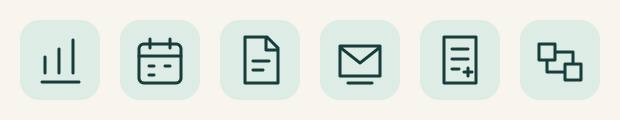

# Presentation assets

Original editable artwork for Healthcare Agents, created for this repository on October 22, 2026. Distributed under the repository's [Apache-2.0 license](../../../LICENSE). No stock artwork, external icon pack, image generator, patient material or private evidence was used. The bracket-and-dot mark represents organizing evidence; it is not a medical certification symbol.

| Files | Purpose |
| --- | --- |
| `hero.svg`, `hero.png` | Desktop README cover, 1280 × 640 |
| `hero-mobile.svg`, `hero-mobile.png` | Narrow-screen cover, 640 × 660 |
| `workflow.svg`, `workflow.png` | Desktop conceptual workflow, 1200 × 820 |
| `workflow-mobile.svg`, `workflow-mobile.png` | Narrow-screen workflow, 640 × 1180 |
| `mark.svg`, `mark.png` | Bracket-and-dot identity, 96 × 96 |
| `icon-{denials,access,evidence,appeal,contract,barriers}.svg` | Six original line icons, 80 × 80 each |
| `icons-preview.png` | Icon contact sheet, ordered as above, 620 × 120 |

SVG is the editable source. PNG is a separate rendered derivative. Text remains editable and declares DejaVu Sans, Arial and a generic sans-serif fallback; no font files are bundled. Exact SVG typography can vary by viewer. The committed PNGs preserve the reviewed render.

## Meaning and text alternatives

The cover says: **Healthcare Agents. Clearer evidence. Reviewable next steps. Skills and workflows for healthcare administration.** The desktop illustration adds: frame the task, check the sources, draft for review, with human-owned decisions.

The workflow says: an administrative task and selected skill or workflow lead to a host-produced draft using approved evidence and dates. Optional local calculation uses validated aggregate inputs and feeds the draft. Qualified human review precedes authorized next steps. A draft or calculated metric does not establish operational completion. Arrows summarize conceptual handoffs, not automatic execution or a mandatory sequence of API calls. The mobile variant preserves the optional branch and human-review endpoint.

Use the matching mobile image through a `<picture>` source when supported. Keep the workflow's meaning in nearby prose as well as image alt text. Do not require readers to decode small image labels, and do not use color as the only distinction. Icons can be decorative beside equivalent visible workflow names.

## Design and source grounding

The visual system uses dark ink (`#163C3B`), warm paper (`#F7F5ED`), secondary ink (`#48615D`), teal (`#177369`), mint (`#DDECE4`) and a restrained coral accent (`#D57D61`). Shared rounded forms, plain line geometry and generous spacing connect the identity and diagrams. The cover uses a two-column editorial layout; mobile sources recompose rather than crop it.

Content follows the repository [overview](../../../README.md), [case contract](../../admin-v2/case-contract.md) and [MCP guide](../../platforms/admin-v2-mcp.md): the host model drafts, local tooling validates/calculates, and qualified people own review and authorized action. The artwork makes no benchmark, efficacy, compliance, publication or host-qualification claim.

Ingenium guidance was read at source commit `c8e4e6f283cde78925b87076fc766a87ffaf6ca7`: the skill plus composition, SVG, diagram-meaning and delivery-context references. Guidance informed the design; no example composition or artwork was copied. [Pinned guidance](https://github.com/ajhcs/Ingenium/tree/c8e4e6f283cde78925b87076fc766a87ffaf6ca7/skills/ingenium).

## Verification

All eleven SVGs parse as XML and carry a title and description. They contain local geometry and text without external resources, scripts or event handlers. PNG previews were rendered with the existing Sharp 0.35.4 / librsvg 2.62.91 installation and opened for visual review. Label spacing and the mobile optional-calculation branch were corrected after preview inspection. All PNG metadata and dimensions were read successfully; the six icons were also reviewed together in the contact sheet.

Measured opaque text/background pairs used by the illustrations range from 5.59:1 (teal on off-white) to 11.03:1 (ink on paper); secondary ink on paper is 6.12:1. These checks do not establish complete accessibility or acceptance by every README viewer. Narrow-screen diagrams still require the adjacent text equivalent.

The optional Ingenium bounded SVG helper refused ARIA attributes (`role`), so PNGs were exported directly through the existing Sharp renderer while preserving accessible SVG sources. No dependency was installed for export.
